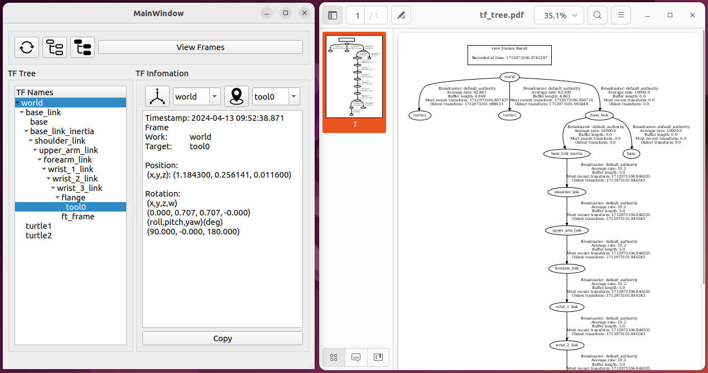

# ARC TF Viewer

## About

A tool for visualizing TF frames coordinate systems through a UI



## Usage

Run some example programs that can generate TF, for example:

```shell
ros2 launch turtle_tf2_py turtle_tf2_demo.launch.py
```

```shell
ros2 launch ur_description view_ur.launch.py ur_type:=ur10
```

Then run the UI:

```shell
ros2 run arc_tf_viewer ui
```


## Install

Because it's written in Qt, compiling will require Qt.

```shell
sudo apt install qtcreator
```

**Download:**

```
cd ~/ros2_ws/src
git clone https://github.com/HowardWhile/arc_tf_viewer.git
```

Installing the necessary ROS packages, most of which are related to `tf2_ros`, so they are typically included with a standard ROS2 installation.

```shell
rosdep install --from-paths src --ignore-src
```

**Compile:**

```shell
cd ~/ros2_ws
colcon build
```

**Execute:**

```shell
source install/setup.bash
ros2 run arc_tf_viewer ui
```


## Next

I want to add a scope to display TF information similar to [ScottPlot](https://scottplot.net/)....


## Static TF editor

Select **Static TF** to open the editor while keeping the main window available.
Choose an existing parent frame and enter a new child frame, or select the root
of a disconnected TF branch. Refresh frames if the desired frame has not yet
appeared. Parent and child are locked while publishing is enabled.

Adjust XYZ and roll/pitch/yaw with the numeric fields or the repeatable +/−
buttons. The step buttons use the currently displayed units. Unit switches
change the display only; the URDF preview always uses meters and radians.
Copy the fixed joint preview into a URDF or xacro and include the child link
only when it has not already been declared.

The 3D preview shows X in red, Y in green, and Z in blue. Drag to rotate or use
the mouse wheel to zoom; these actions pause automatic camera motion. Use
**Auto orbit** to resume orbiting or **Reset view** to restore automatic framing.

Enable publishes a static transform and updates it whenever the pose changes.
Disabling stops publishing, but a static transform already received by another
node may remain in its TF cache. The application saves editor settings in the
user's configuration directory; publishing is always disabled on startup.
